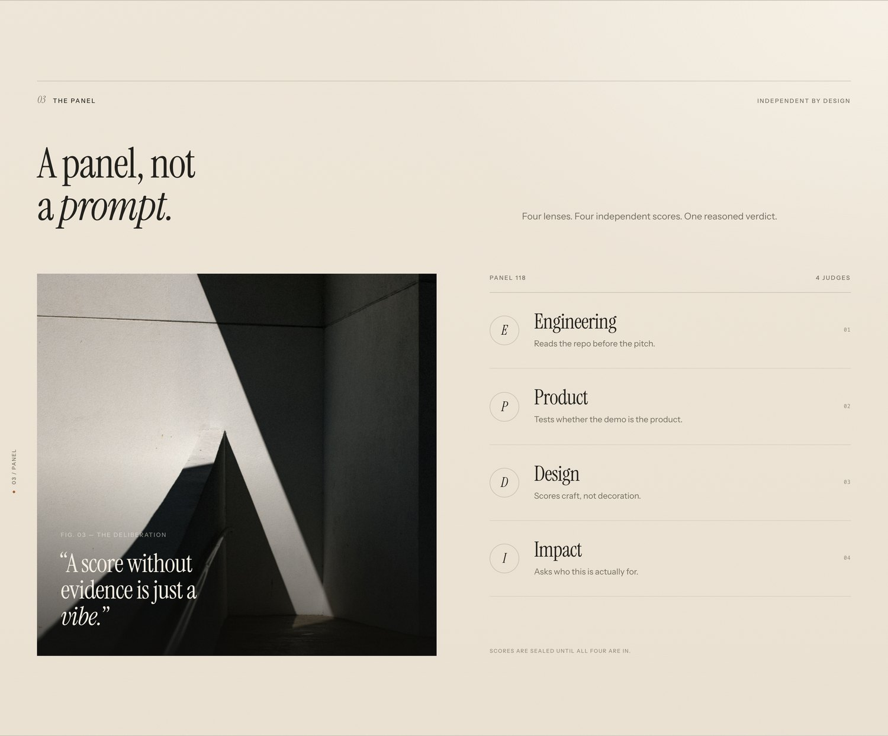

<div align="center">
  <a href="https://abhinav-prabhakar.github.io/jury/">
    
  </a>
</div>

<br>

<h1 align="center">Jury</h1>

<p align="center">
  <em>Every project deserves a verdict.</em><br>
  An AI judging panel for hackathons — a static, editorial landing page<br>
  in warm paper, charcoal serif and cinematic plates.
</p>

<p align="center">
  <a href="https://abhinav-prabhakar.github.io/jury/"></a>
  
  
  
</p>

<p align="center">
  
  
  
  
  
</p>

<br>

<p align="center">
  <a href="#the-verdict">The verdict</a> ·
  <a href="#the-method">The method</a> ·
  <a href="#the-panel">The panel</a> ·
  <a href="#selected-records">Selected records</a> ·
  <a href="#run-it-locally">Run it</a>
</p>

<br>

## The verdict

A landing page built to feel like a printed record rather than a SaaS template.
A specimen verdict card, a four-pass method rail and a panel of independent
specialist judges — each screen carries one idea, then gets out of the way.

<table>
<tr>
<td width="50%" valign="top">
  
  <br>
  <sub><b>01 · The specimen verdict.</b><br>A score you can argue with — four dimensions, one dissent, one reason.</sub>
</td>
<td width="50%" valign="top">
  
  <br>
  <sub><b>02 · The panel.</b><br>Engineering, Product, Design, Impact. Four lenses, independent scores.</sub>
</td>
</tr>
</table>

<br>

<table>
<tr>
<td width="50%" valign="top">
  
  <br>
  <sub><b>03 · The method.</b><br>One pipeline, four passes. No skipped repositories.</sub>
</td>
<td width="50%" valign="top">
  
  <br>
  <sub><b>04 · The archive.</b><br>Full-bleed atmosphere between the argument and the evidence.</sub>
</td>
</tr>
</table>

<br>

<table>
<tr>
<td width="50%" valign="top">
  
  <br>
  <sub><b>05 · Selected records.</b><br>An asymmetric mosaic, graded to the same warm palette.</sub>
</td>
<td width="50%" valign="top">
  
  <br>
  <sub><b>06 · The enquiry.</b><br>Six fields become three. A form that reads like correspondence.</sub>
</td>
</tr>
</table>

<br>

## The panel, in your pocket

<div align="center">
  
  &nbsp;&nbsp;&nbsp;
  
</div>

<p align="center"><sub>One layout, no breakpoints bolted on — type scales, plates crop, the card stacks.</sub></p>

<br>

<details>
<summary><b>See the whole page</b></summary>
<br>

</details>

<br>

## Under the paper

- **Palette** — warm sand <code>#F2ECE1</code>, ink <code>#22211D</code>, ember <code>#A45C39</code>.
- **Type** — Instrument Serif for display, Instrument Sans for text, system mono for record data.
- **Photography** — local plates, sepia-graded in CSS; no runtime image service.
- **Motion** — reveals, counters and parallax, all disabled under <code>prefers-reduced-motion</code>.
- **Access** — skip link, focus-visible states, trapped menu focus, Escape to close, labelled form errors.
- **Form** — front-end only: validates, then shows a success state. Nothing is sent.

## Run it locally

```sh
git clone https://github.com/Abhinav-Prabhakar/jury.git
cd jury
python3 -m http.server 8000
```

Open <http://localhost:8000>. No install, no build, no dependencies.

```text
index.html      Landing page
credits.html    Colophon
styles.css      Tokens, layout, responsive rules
main.js         Menu, reveals, parallax, counters, form, clocks
assets/img/     Local photography
docs/           README plates
```

<br>

<p align="center">
  <a href="https://abhinav-prabhakar.github.io/jury/credits.html">Colophon</a> ·
  <a href="https://github.com/Abhinav-Prabhakar/jury">Source</a> ·
  <a href="https://github.com/Abhinav-Prabhakar/jury/issues">Issues</a>
</p>

<p align="center"><sub>Jury is a fictional product. Names, verdicts and statistics are invented.</sub></p>
